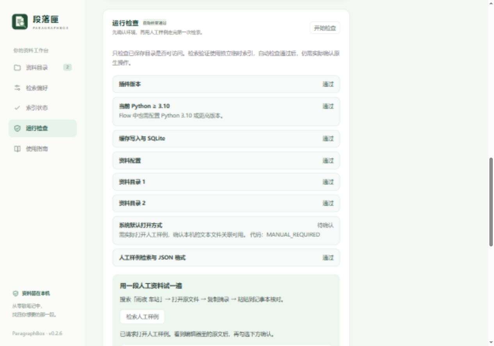

# 0.2.6 验收记录

本版新增运行检查、人工样例引导和脱敏诊断摘要。自动检查与手动确认分别显示；自动检索、动作请求和浏览器复制响应不代表原生操作已经完成。

2026-10-11，Windows、Python 3.14.5。86 项 Python 检查中 85 项通过，1 项因系统缺少符号链接权限跳过；Windows 目录联接隔离与打包检查通过。JavaScript 语法检查通过。

## 自动验证

- 损坏配置仍能返回运行检查和脱敏摘要；缓存与人工样例可独立验证，不误报资料目录通过。
- 目录缺失、所选编辑器不可用、缓存写入失败和安装样例变化均有固定错误代码与建议；原始异常消息不进入摘要。
- 人工 Markdown/TXT 验证中文多词、章节、第 3 行、JSON 结果与三参数复制动作格式。检索使用独立临时索引，检查前后个人配置、索引字节和进程环境一致。
- 摘要中的路径、别名、原文、原始异常和会话凭据隐私哨兵检查通过。接口沿用本机 Host、Origin 与会话鉴权，拒绝任意路径与额外参数。
- `--doctor` 在损坏配置时输出有效脱敏 JSON、退出码 1、stderr 为空；`--check` 的原有详细字段保持兼容。

## 页面验证

在 1280 像素与 600 像素窗口检查布局，无横向溢出。自动结果、人工检索段落与行号、复制反馈和摘要预览正常；配置损坏时仍可检索人工样例。重新检查和刷新会清除手动确认。

人工样例的打开请求返回成功，浏览器复制返回成功。这些仅证明请求与页面反馈；没有据此勾选手动确认。三项原生操作在摘要中仍为 `pending`。

## 安装与边界

安装包使用明确文件白名单，默认资料与截图均为人工内容，不包含个人配置、索引、日志、运行环境或会话文件。0.2.5 覆盖升级验证配置字节、插件 ID、旧索引和中文查询结果保留。独立解压目录的新进程运行 `--doctor` 和 Flow JSON 查询入口通过；本地已安装副本更新至 0.2.6，配置和索引保留。

自动检查不能确认 Flow 主窗口是否成功加载、编辑器里的实际内容或系统粘贴结果。首次使用引导要求实际完成后再勾选确认；所选 VS Code 的精确定位仍需沿用 [0.2.5 待验收项目](verification-0.2.5.md)。本版继续标为早期预览版。
